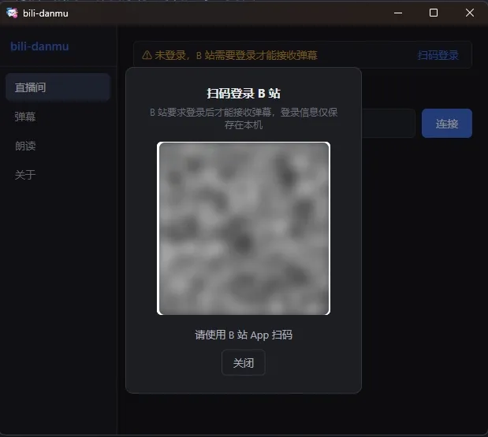
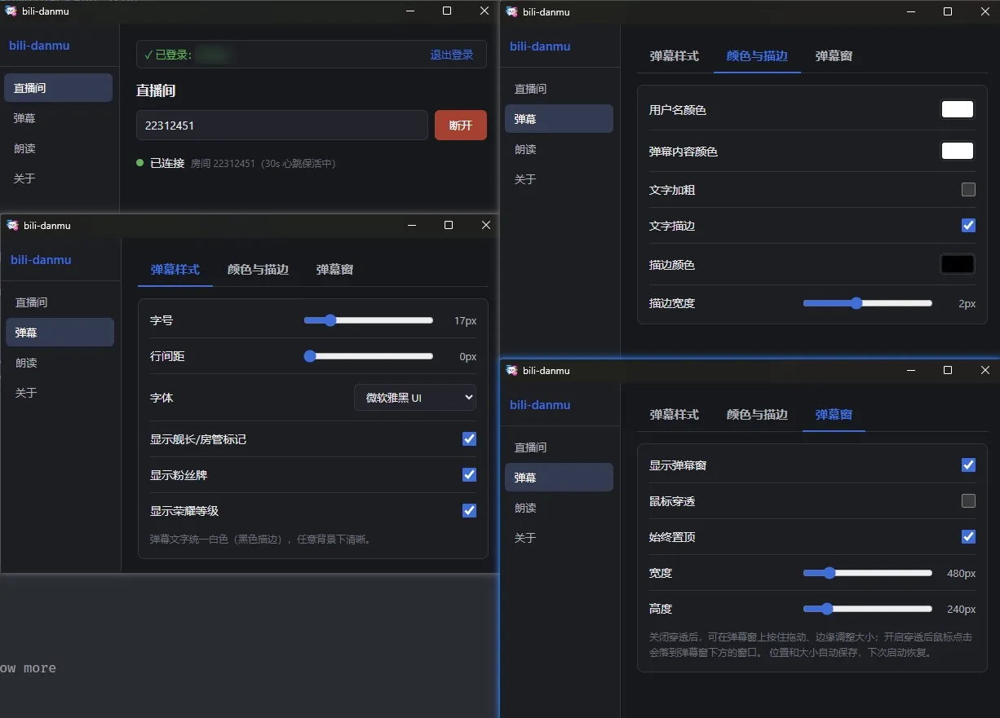
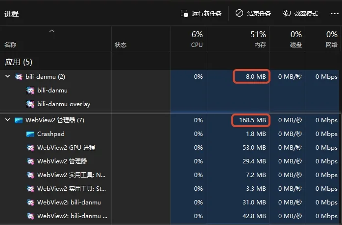
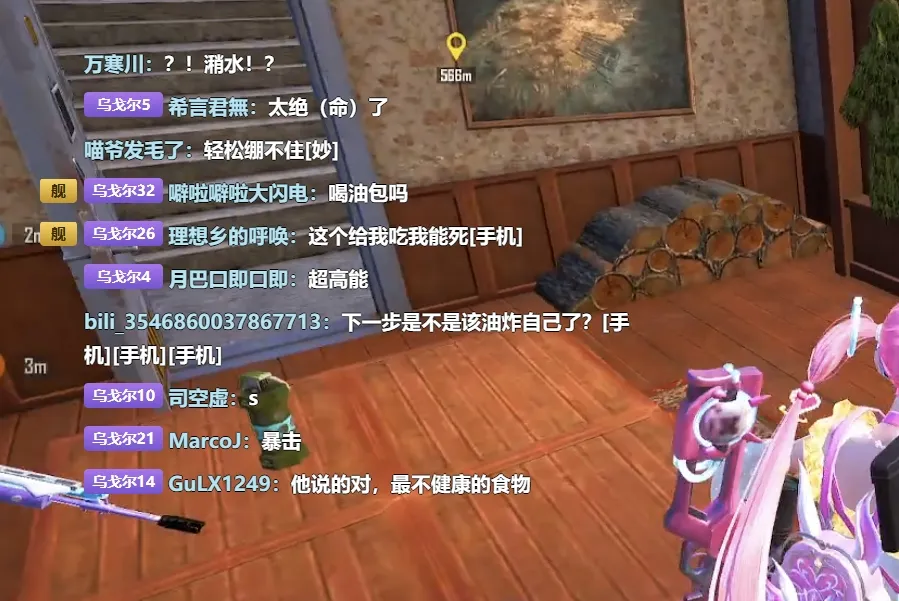

# bili-danmu <Badge type="tip" text="版本: 0.6.0" /> {#bili-danmu}

一个轻量版弹幕助手：连上 B 站直播间，弹幕就实时显示在桌面透明悬浮窗里。装它只为这一件事。

## 什么时候用? {#when-to-use}

- **和主播开黑的水友**：人在游戏里腾不开手，又不想错过直播间的弹幕。窗口贴在画面角落，余光一扫，大家聊到哪、在刷什么梗，心里有数。不用切窗口，不用低头掏手机。
- **用 OBS 推流的主播**：要一块能一直盯着的弹幕区域，又不想让画面显得乱。悬浮窗透明、无边框，叠上去几乎看不出多了一层；开了鼠标穿透，操作都落在后面的窗口上。

## 为什么没直接用现成的 {#why-not-existing}

原来在用的[弹幕库](http://bilibili.danmaku.live/)停更了，B 站协议一升级，它就再也收不到弹幕。

现成的要么装在electron框架里，安装包又大、又占内存, 电脑跑着游戏已经很吃力了，主播还要开直播软件

再开一个耗内存的软件实在心疼。

没有趁手的，干脆自己写一个，砍掉花活，核心就一条：

> 输入房间号 → 连接 → 弹幕出现在透明悬浮窗(后续增加弹幕朗读方便主播使用)。

## 上手三步 {#getting-started}

1. 打开软件，扫码登录。
2. 填房间号，点「连接」
3. 弹幕在悬浮窗里滚动起来

## 用起来怎么样 {#experience}

主窗口就四个页面：直播间、弹幕、朗读、关于。目前真正干活的是前两个——「直播间」填号、连接、看状态；弹幕相关的设置都在「弹幕」页，样式、颜色、窗口做成三个标签，不用层层翻菜单。

它本体占的内存大约 8MB。

弹幕窗是透明悬浮的，没边框，可以置顶、拖动，拽边缘能改大小。位置和大小会自动记住，下次打开还在老地方。设置里的鼠标穿透挺实用：打开后，点击直接落到窗口后面的游戏，不会误点到弹幕上。

弹幕的字体、字号、颜色、描边都能调，改完立刻生效，也会自动存下来。默认白字黑描边，不管背后画面多花，字都看得清。谁在说话也分得清：舰长、房管、粉丝牌、荣耀等级各自有开关，只想留粉丝牌，就把别的关掉。

登录状态和设置只保存在本机，不收集数据，不上传日志。

## 目前还没做的 {#not-implemented}

礼物、SC(付费弹幕)这些事件还没解析，现在只能看到普通弹幕。现在是列表式往上排。朗读（TTS）还是占位页，自动重连、全局快捷键都在计划里。

## 为什么能做到这么轻 {#why-lightweight}

窗口、网络这类底层活交给 Tauri 2 + Rust 的系统原生能力，前端 Vue 只负责渲染界面，体积和内存自然压得下来。

B 站弹幕协议参考了开源的 [DanmuFree](https://github.com/SoraYjy/DanmuFree)，代码以 GPL v3 开源。

项目地址: https://github.com/bd-dxg/bili-danmu

软件下载: https://github.com/bd-dxg/bili-danmu/releases/latest

